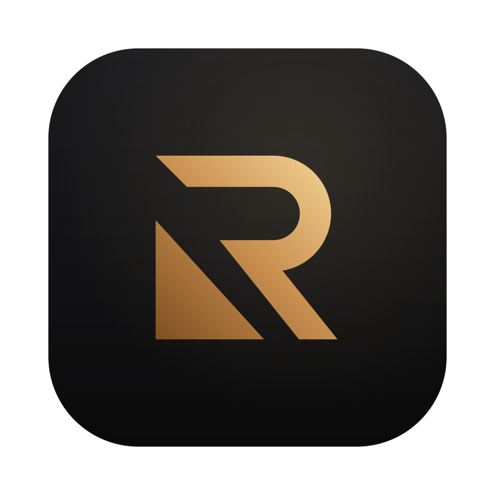
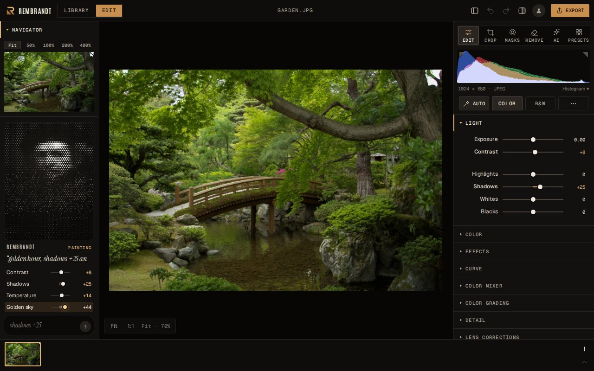
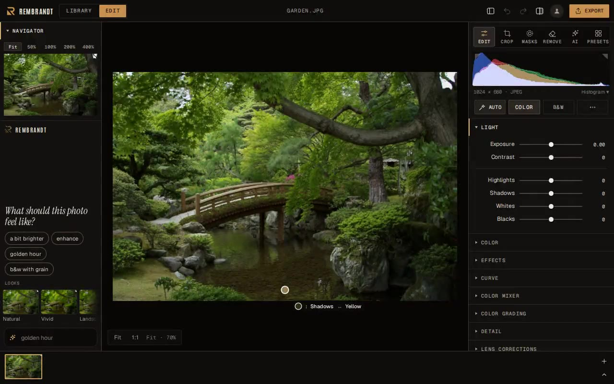
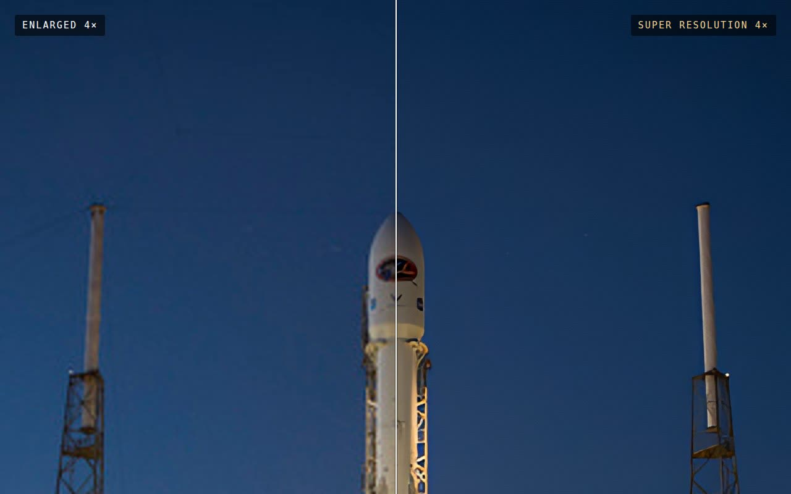
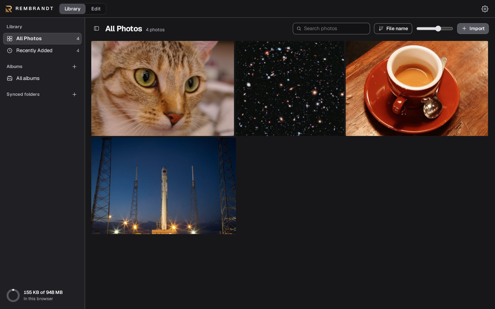
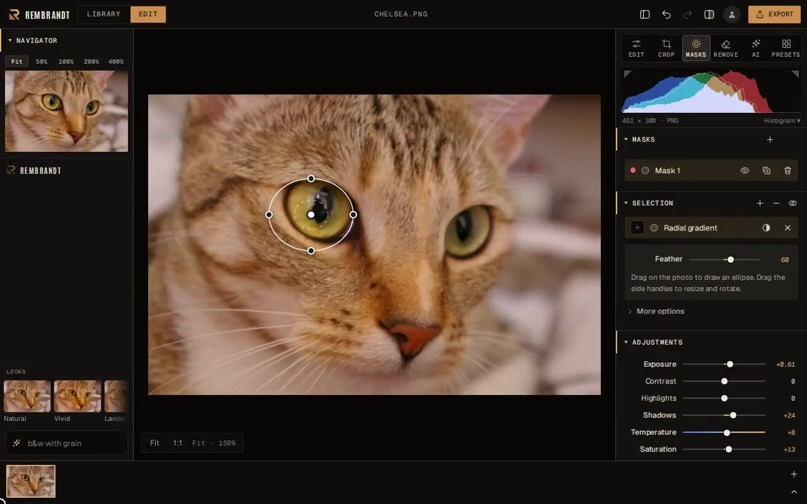
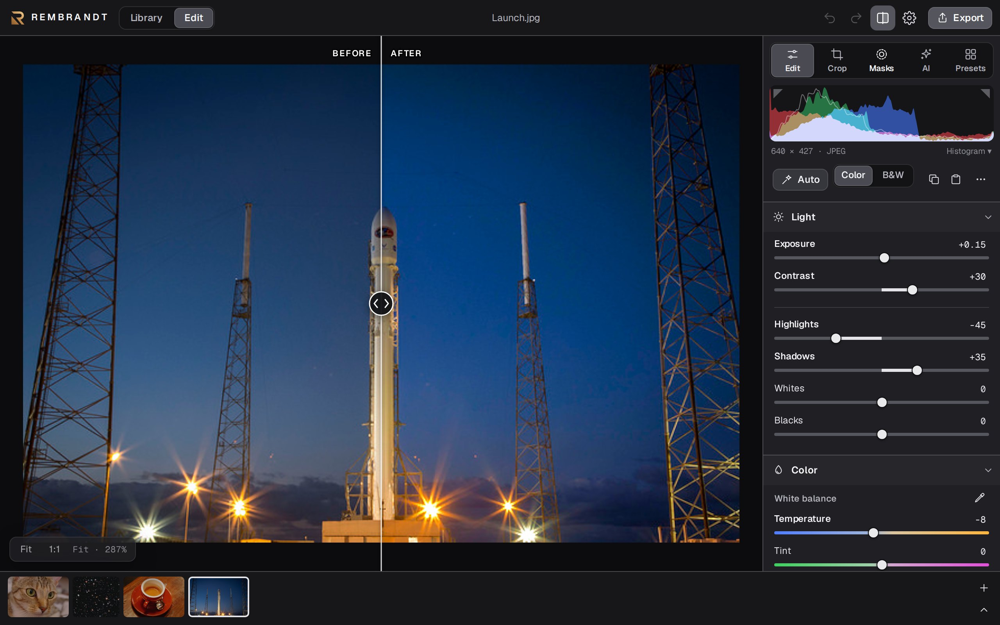

<p align="center"></p>
<p align="center"><a href="https://github.com/thesnarkitecht/rembrandt/stargazers"></a> <a href="https://github.com/thesnarkitecht/rembrandt/releases/latest"></a> </p>
<h1 align="center">Rembrandt</h1>
<p align="center"><b>Stop paying for Adobe. Flush the incrapification.</b></p>
<p align="center">A free photo editor for macOS, Windows and Linux.<br>
No account needed, no subscription, no “we’ve updated our terms” emails.</p>
<p align="center">
  <a href="#download"><b>Download</b></a> ·
  <a href="#quick-facts">Quick facts</a> ·
  <a href="#self-host-it">Self-host</a> ·
  <a href="#features">Features</a> ·
  <a href="#how-it-compares">Compare</a> ·
  <a href="#build">Build</a>
</p>

<p align="center"><a href="https://rembrandteditor.dev/video/demo.mp4"></a><br><sub>▶ Watch the 26-second demo</sub></p>

<table>
  <tr>
    <td width="33%"></td>
    <td width="33%"></td>
    <td width="33%"></td>
  </tr>
  <tr>
    <td align="center"><sub><b>Ask</b>: “golden hour, shadows +25”, and watch Rembrandt paint it</sub></td>
    <td align="center"><sub><b>Touch</b>: drag on the photo to change that tone or colour</sub></td>
    <td align="center"><sub><b>Super Resolution</b>: 2× and 4× on your GPU</sub></td>
  </tr>
  <tr>
    <td width="33%"></td>
    <td width="33%"></td>
    <td width="33%"></td>
  </tr>
  <tr>
    <td align="center"><sub><b>Library</b>: albums, search, sorting, one-click delete</sub></td>
    <td align="center"><sub><b>Masks</b>: brush, gradients, AI subject and depth</sub></td>
    <td align="center"><sub><b>Before / after</b>: split or side by side</sub></td>
  </tr>
</table>

> [!NOTE]
> **The editing engine is still changing.** Rembrandt is young, and how edits are processed (RAW
> development, colour, tone sliders) may change between versions while it improves. The same
> edit can look slightly different after an update. Your originals are never modified, and your
> edits are saved as settings in XMP sidecars, so nothing is lost; check important work after
> updating before you export it again.

## Download

| Platform | |
|---|---|
| macOS · no admin password | `curl -fsSL https://raw.githubusercontent.com/thesnarkitecht/rembrandt/main/install.sh \| bash` |
| macOS · Apple silicon | [Rembrandt-macos-arm64.dmg](https://github.com/thesnarkitecht/rembrandt/releases/latest/download/Rembrandt-macos-arm64.dmg) |
| macOS · Intel | [Rembrandt-macos-x64.dmg](https://github.com/thesnarkitecht/rembrandt/releases/latest/download/Rembrandt-macos-x64.dmg) |
| Windows · x64 | [Rembrandt-windows-x64-setup.exe](https://github.com/thesnarkitecht/rembrandt/releases/latest/download/Rembrandt-windows-x64-setup.exe) |
| Windows · ARM | [Rembrandt-windows-arm64-setup.exe](https://github.com/thesnarkitecht/rembrandt/releases/latest/download/Rembrandt-windows-arm64-setup.exe) |
| Linux · x86_64 / arm64 | `curl -fsSL https://raw.githubusercontent.com/thesnarkitecht/rembrandt/main/install.sh \| bash` |

All files and checksums: [Releases](https://github.com/thesnarkitecht/rembrandt/releases).
On a Mac the install line puts Rembrandt.app in `~/Applications` without an administrator password
and adds a `rembrandt` command: `rembrandt gui` opens the app, `rembrandt update` updates it and
`rembrandt uninstall` removes it. It opens without the "can't verify" prompt.
Builds aren't code-signed yet: with a downloaded .dmg, use System Settings → Privacy & Security →
**Open Anyway** on macOS, and **More info → Run anyway** on Windows.

## Self-host it

Serve Rembrandt from the computer that holds your photos and edit them in any browser:

```sh
curl -fsSL https://raw.githubusercontent.com/thesnarkitecht/rembrandt/main/install.sh | bash -s -- --server
```

It asks which photo folder to use, starts at login, and prints a private link. Edits are saved next
to each photo as XMP; the photos themselves are never changed. Add `--lan` to reach it from other
devices on your network. Linux and macOS; one small dependency-free binary (`server/`).
To update, press **Update** in the browser (Settings › About); it installs the latest release,
checks it against the published SHA-256 sums, and restarts the server.

## Features

- **Ask in words**: type “warmer and a bit brighter”, “down exposure by ten points”, “shadows +25”
  or “paste the edits from the previous photo” (Ctrl/⌘ K), or say it: press the microphone in the
  side panel and say “bring lens blur down”. A small Rembrandt in dots thinks it over,
  then makes each change while you watch the sliders move. It understands everyday phrasing too
  (“the sky is too white”, “it looks too yellow”, “start over”) through
  [Needle 3](https://huggingface.co/Cactus-Compute/needle3), a 36 MB language model that runs on your
  device; exact requests like “shadows +25” never need it, and with AI off the words still work.
- **Edit the photo itself**: drag up or down on any part of the picture to lighten or darken that
  tone, left or right to change that colour; the sliders follow.
- **HDR**: a live HDR section in Edit. One tap for Natural, Balanced, Dramatic, Sky or Interior, then
  Strength, Balance (shadows or highlights) and Detail. It opens shadows and brings highlights down
  without halos, and stays editable like any slider.
- **Studio Light**: one-click lighting set-ups (Soft, Rembrandt, Split, Butterfly, Rim, Stage, High key,
  Golden) that light the subject from a direction using the depth map, with Strength, Direction, Fill,
  Rim light, Backdrop and Warmth.
- **AI looks**: Enhance, Relight, Sky (deepen it, or replace it with a clear, cloudy, golden-hour,
  sunset or dusk sky that relights the scene), Atmosphere, Sunrays, Skin, Motion and Lens Blur with
  aperture shapes, from on-device depth and subject maps.
- **Refocus**: brings back detail in out-of-focus photos, even heavy defocus (regularised
  deconvolution on the GPU), on the subject or the whole picture.
- **Super Resolution**: 2× and 4× with real detail, or Restore at the same size for soft photos;
  runs on the GPU (Metal on Apple silicon).
- **AI Denoise**: clean high-ISO shots into a new DNG with the same edits, on the GPU.
- **Background work that stays out of the way**: AI Denoise, Super Resolution and merges run in small
  GPU slices that pause while you edit, or when you're away, or overnight in a night window you set
  (Settings › Performance). The queue survives restarts.
- **Merge**: HDR from brackets, panoramas and focus stacks, each to a RAW-like DNG. **HDR from one
  photo** makes darker and brighter exposures of a single shot and blends each where it looks best,
  so shadows open and highlights hold without a tripod or brackets.
- **RAW** from 1,000+ cameras, developed on the GPU: tone, colour, curves, grading, dehaze, detail.
  Default colour measured against Camera Raw on test charts, and the tone sliders (Highlights,
  Shadows, Whites, Blacks) are broad, overlapping zones fitted to how Lightroom's move each tone, so
  adjustments blend into the light around them, without halos, banding or hue shifts. A 24 MP RAW is
  ready to edit in a second or two (half size first, full size in the background), and going back to
  one you just had open is instant. Two profiles of our own: **Rembrandt Standard** (neutral, matched
  to Camera Raw) and **Rembrandt Color** (the default: a little more contrast, richer reds and
  yellows, calmer greens), or **Match my camera** for your camera's own look.
- **Your workspace**: hide the tools and panel sections you don't use (Settings › Workspace), and
  turn AI off altogether: its tools disappear and no model is downloaded or run.
- **Made for old computers too**: Rembrandt times your graphics card once and picks a working size it
  can keep up with, works at half size while a slider moves, and needs only WebGL 2 (OpenGL 3.3-class
  graphics).
- **Looks**: film-style colour (Portrait 400, Vivid 50, Chrome, Tungsten 800, Matte, Pan 400 B&W) with
  an Amount slider, and your own 3D LUTs: import any `.cube` file once and use it on every photo.
- **Masks**: brush, gradients, colour and tone ranges, AI subject, background, object and depth, and
  People: face skin, body skin, hair, eyebrows, eye whites, irises, lips, teeth and clothes.
- **Remove**: paint over anything and **Generative Remove** fills it with what was most likely behind it
  (a small inpainting network, no upload: in the desktop app on every CPU core, and on Apple silicon
  on the Neural Engine through Core ML). **People in the background**
  finds and removes passers-by in one click and keeps your subject. Heal and Clone copy from a matching
  part of the photo. **Remove blemishes** heals spots on portraits in one click and keeps moles and beauty marks.
  **Visualize spots** shows sensor dust and specks as white on black and **Remove all dust** heals them in one go; **Color speckles** (Detail)
  clears red and other colour dots at small high-contrast points that noise reduction can't reach.
- **Portraits**: Smooth skin, Light the face, Brighten eyes, Define irises and Whiten teeth, each one
  slider on an AI People mask you can fine-tune in Masks.
- **Reshape** (L): face sculpting (Eyes, Face width, Nose, Smile) from the AI's face landmarks, and
  Liquify brushes (Push, Bloat, Pucker, Restore).
- **Generative Expand** (Crop): a wider, taller or square copy of the photo, its new edges filled with
  what plausibly continues the scene.
- **Edit like me**: after a few edits, Rembrandt edits a new photo the way you would. It learns from
  the photos you've edited, by what each looked like before you touched it, so a dark photo still
  gets lifted the way you like. On your device; nothing to train or upload.
- **Make these consistent**: select a shoot, pick a hero frame, and every other frame's exposure and
  white balance are matched to it by measuring the results, keeping the rest of each photo's edits.
- **Match my camera**: every RAW carries the JPEG the camera made from it. Rembrandt learns your
  camera's own colour and tone from those JPEGs, per camera model, and applies it with one switch.
- **Pick the best**: select a shoot and Rembrandt groups the bursts, picks the sharpest frame with
  open eyes in each and rejects the blurry and eyes-closed ones. Your own flags are kept; one Undo.
  **Compare** (C) shows 2–4 frames side by side with zoom and pan linked.
- **Lens corrections**: the camera's built-in profile from Fujifilm and Sony RAWs, or one of 1,500
  lens profiles from [Lensfun](https://lensfun.github.io) (distortion, vignetting, chromatic
  aberration), plus manual distortion and vignetting for any photo, and **Auto distortion** for lenses
  with no profile, which straightens the photo's straight lines. Auto straighten levels horizons;
  Transform's Vertical and Horizontal fix converging lines, and Auto makes a building's verticals parallel.
- **On-device AI**: Refocus, background replacement. Nothing is uploaded.
- **Smart search**: type “dog on the beach” or “red car” and find the photos, with no keywording.
  On-device (CLIP, a 155 MB model downloaded once when you turn it on in Preferences); photos and
  searches never leave your computer.
- **Library**: albums, ratings, flags, colour labels, keywords, virtual copies, search, Find similar,
  sorting, keyboard shortcuts (or Lightroom's), one-click delete with Undo.
- **Batch**: copy and paste edits to hundreds of photos, batch export, and presets that fit each
  photo's exposure. Imports Lightroom presets (.xmp, .lrtemplate and zip packs). Watch a folder to
  apply a preset and album to new photos as they arrive.
- **Point Color** (Color Mixer): pick a colour in the photo and shift just that one, hue, saturation and
  luminance, with a range. Up to eight.
- **Snapshots**: save versions of an edit under a name and go back to any of them.
- **Tethered shooting** (desktop app, macOS and Linux): the camera on a USB cable, the shutter fired
  from the app (F12) or the camera; each photo opens as it lands, with the previous photo's edit or a
  preset, in the day's album.
- **Share how**: a before/after page with a slider, a replay video of the edit, or the recipe inside
  the exported file so anyone can see (and reuse) how it was edited.
- **Bring your photos**: folders, Lightroom Classic (edits, keywords, labels, virtual copies,
  collections, with a report of anything that can't come over) and Lightroom, Google Photos, Google Drive,
  Dropbox, OneDrive ([setup](docs/cloud-services.md)). Export back to them too.
- **Open formats**: edits are standard XMP, readable by Lightroom and others. Export to JPEG (optionally
  **HDR**: an Ultra HDR JPEG whose highlights shine on HDR screens and look normal everywhere else), PNG, WebP
  or TIFF, with an optional watermark and export presets (Instagram, web, print, or your own), and
  **Content Credentials** (desktop app): a signed record of the edits inside the file, generative AI
  marked as such; exports keep the camera details and date taken, add your name
  and copyright, and embed an sRGB profile; location is never written.

## Quick facts

| | |
|---|---|
| **What it is** | A RAW developer and photo library, in the same family as Lightroom Classic: develop, adjust, mask, retouch, organise and export your own photos. Every edit is non-destructive. |
| **What it isn't** | A layer-based pixel editor like Photoshop or GIMP (no layers, text or painting), or a generative AI tool: it doesn't make images from a prompt or invent new objects. Its AI effects (fog, sun rays, lens blur, background replacement with a picture you choose) are built from each photo's own depth and subject. |
| **The AI** | Selects people, faces, subjects, objects and depth for masks, removes blemishes, denoises, refocuses, upscales and picks your best shots. It all runs on your computer. |
| **Typing or talking** | You can ask for edits in words ("warmer", "the sky is too white", "lens blur down") or by voice. It understands photo edits, not general requests. |
| **Your photos** | Stay on your computer. Originals are never changed; edits are saved as standard XMP that Lightroom and darktable read. |
| **Cost** | Free, no account. There is no Rembrandt Cloud or sync service yet. |
| **Runs on** | macOS, Windows and Linux, or self-hosted and used in any browser. |
| **Coming from Lightroom** | Imports your catalog (edits, keywords, collections) and your presets (.xmp and .lrtemplate). |
| **Not here yet** | Print, Book, Slideshow and Map modules, tethered capture, plugins. |
| **Licence** | GPL-3.0-or-later. Free to use, study, change and share. |
| **Found a bug?** | [Open an issue](https://github.com/thesnarkitecht/rembrandt/issues/new/choose) with your version (Settings › About) and how to make it happen. Please don't send photos to be edited. |

## How it compares

- **Lightroom**: the everyday editing and library work is here: RAW development, masks (including AI
  subject, depth and object), healing, presets, lens corrections, HDR and panorama merges,
  denoise, batch editing, and catalog import. Not here yet: Print, Book, Slideshow, Web and Map
  modules, face recognition, Adobe's camera profiles, tethered capture (a watched folder covers most
  tethering apps), and a plugin ecosystem.
- **darktable**: Rembrandt borrows darktable's central idea, a *scene-referred* pipeline (edits work
  on linear light before a tone curve maps it to the screen), which is why highlights recover cleanly.
  darktable has far more modules and control; Rembrandt aims to be usable in five minutes, with fewer,
  broader controls and on-device AI. The engine is an independent implementation (see Credits).
- **LightCraft**: a newer open-source Lightroom reimplementation in Rust, from the ArtCraft team, with
  more of Lightroom's library and export surface (stacks, Survey view, all of Upright's modes, AVIF and HDR export)
  and an MCP server for AI agents. By [its own status table](https://github.com/storytold/lightcraft#feature-status),
  its AI masks and denoise are still classical heuristics or in progress and Super Resolution isn't
  started; some CR3, Olympus and Nikon HE RAWs don't decode yet. Rembrandt's on-device AI (People and
  subject masks, AI Denoise, Super Resolution, Refocus, blemish removal, culling by focus and eyes),
  the features that learn from you (Edit like me, Match my camera, Make these consistent) and
  LibRaw's 1,000+ cameras are where it differs most.
- **RawTherapee / ART**: similar ground to darktable; Rembrandt trades depth of control for speed of use.
- **GIMP / Photoshop**: different kind of tool. Those are pixel editors for compositing and painting;
  Rembrandt is a non-destructive RAW developer and library, like Lightroom.

## Your photos aren't locked in

Rembrandt never moves or rewrites your originals. Edits are saved as standard XMP sidecars next to
your photos, which Lightroom, darktable and others can read, and Settings › Data & privacy exports a backup of all your edits.
If Rembrandt disappeared tomorrow, your library and your edits would still be yours, in open formats.

## How it's built

JavaScript with WebGL2 and WebGPU shaders for the editing engine and on-device AI, in a Rust
([Tauri](https://tauri.app)) desktop app. RAW files are decoded by [LibRaw](https://www.libraw.org):
in the desktop apps natively (C++ built for Apple Silicon, x86-64 and ARM), with the conversion for the
GPU spread over every core; in browsers as WebAssembly. Both give the same pixels. Every release is built by GitHub Actions from this repository, with
checksums and signed build provenance ([SECURITY.md](SECURITY.md)).

## Credits

- [darktable](https://www.darktable.org): the scene-referred workflow Rembrandt's engine is modelled on.
  An early prototype ported darktable's algorithms; it was replaced by an independent implementation of
  the published methods (listed in [NOTICE.md](NOTICE.md)) before the code was released.
- [LibRaw](https://www.libraw.org) (RAW decoding), [Lensfun](https://lensfun.github.io) (lens profiles),
  [RAWmakase](https://github.com/pch/rawmakase) (lens tables, heal and clone),
  [Real-ESRGAN](https://github.com/xinntao/Real-ESRGAN) (Super Resolution),
  [KAIR / FFDNet](https://github.com/cszn/KAIR) (AI Denoise), [MediaPipe](https://ai.google.dev/edge/mediapipe)
  (subject, depth and object models). Licences and notices in [NOTICE.md](NOTICE.md).

## Help out

Rembrandt is free and stays free. Star the repo, tell a photographer,
[report a bug](https://github.com/thesnarkitecht/rembrandt/issues) or send a fix.

## Build

```sh
npm ci && npx http-server -c-1 .   # web app
npm run tauri dev                  # desktop app (Rust + Tauri prerequisites)
```

Details in [docs/building.md](docs/building.md). Contributions welcome: [CONTRIBUTING.md](CONTRIBUTING.md).

## Licence

Free software under the [GNU General Public License v3.0 or later](LICENSE), the same licence as
darktable. Use it, study it, change it and share it; if you distribute a modified version, share its
source under the same terms. It may also be distributed through app stores (an additional permission
under the GPL; see [NOTICE.md](NOTICE.md), which also lists the third-party parts).

<sub>Screenshot photos from the scikit-image sample data: espresso by Rachel Michetti and cat by
Stefan van der Walt (CC0), rocket launch by SpaceX and Hubble eXtreme Deep Field by NASA (public
domain).</sub>
